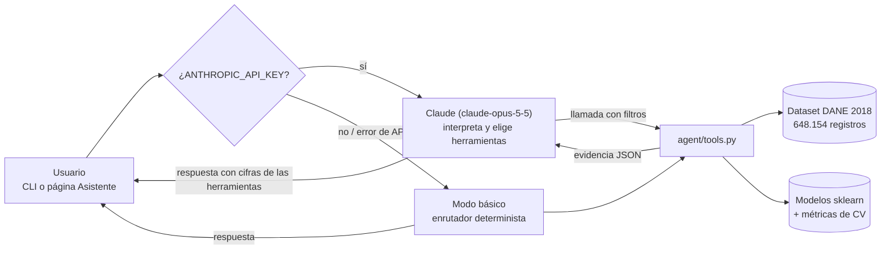

# Predicción de Riesgo Perinatal — DANE Colombia 2018

Juanita Maria Arango Mejia
Carolina Uribe Villa

Sistema de Machine Learning para predecir dos outcomes clínicos críticos en nacimientos
a partir de los microdatos oficiales del DANE (Departamento Administrativo Nacional de Estadística,
Colombia, año 2018).

---

## Problema

Colombia registra anualmente más de 600 000 nacimientos. Dos condiciones neonatales
concentran la mayor carga de morbimortalidad perinatal:

| Condición | Prevalencia (2018) | Impacto clínico |
|---|---|---|
| **Cesárea** | ~45 % de los partos | Recuperación materna más larga, costo hospitalario mayor |
| **Bajo peso al nacer** | ~9 % de los nacimientos | Principal predictor de mortalidad neonatal y morbilidad infantil |

Ambas condiciones son parcialmente predecibles a partir de variables disponibles
**antes** del parto (características maternas, geográficas y de acceso al sistema de salud).
Un modelo que las anticipe puede orientar el cuidado prenatal diferencial.

---

## Arquitectura del Proyecto

```
ju-ca-nacimientos2018/
│
├── data/
│   ├── raw/
│   │   └── nac2018.csv                  # Dataset original DANE (≈649 000 filas, 62 MB)
│   └── processed/
│       └── nac2018_cleaned.csv          # Dataset limpio post-pipeline (~648 000 filas)
│
├── notebooks/
│   ├── 01_limpieza_datos.ipynb          # Limpieza, validación y encoding DANE
│   ├── 02_eda_processor.ipynb           # Análisis Exploratorio de Datos (EDA)
│   └── 03_modelado_ml.ipynb             # Entrenamiento, evaluación y selección de modelos
│
├── src/                                 # Código reutilizable (importable como módulo)
│   ├── __init__.py
│   ├── preprocessing.py                 # Pipeline de limpieza y feature engineering
│   └── train.py                         # Entrenamiento, CV, comparación y persistencia
│
├── app/
│   ├── main.py                          # Interfaz gráfica Streamlit (identidad DANE)
│   └── pages/1_Asistente.py             # Chat con el agente dentro de la app
│
├── agent/                               # Agente de consulta (Claude + herramientas)
│   ├── llm_agent.py                     # Agente con Claude: elige herramientas y conversa
│   ├── agent.py                         # Modo básico sin LLM (respaldo determinista)
│   ├── tools.py                         # Herramientas: conteos, tasas, filtros, predicción
│   ├── catalog.py                       # Códigos DANE verificados (etiquetas)
│   ├── factory.py                       # Elige modo según credenciales
│   └── run.py                           # CLI: pregunta única o chat interactivo
│
├── models/                              # Modelos entrenados (generados al ejecutar)
│   ├── cesarea_pipeline.pkl             # Pipeline sklearn completo para cesárea
│   └── bajo_peso_pipeline.pkl           # Pipeline sklearn completo para bajo peso
│
├── scripts/
│   ├── quick_train.py                   # Entrenamiento rápido sin CV (validación UI)
│   └── generate_notebooks.py            # Generador de notebooks desde Python
│
├── main.py                              # CLI: limpieza + feature engineering + entrenamiento
├── .env.example                         # Plantilla para ANTHROPIC_API_KEY (copiar a .env)
├── pyproject.toml                       # Configuración del proyecto (UV / PEP 518)
├── uv.lock                              # Lock file de dependencias (reproducible)
└── diccionario_datos.md                 # Diccionario de variables DANE
```

### Flujo de datos end-to-end

```
nac2018.csv (crudo, 62 MB, encoding latin-1)
        │
        ▼
  [src/preprocessing.py — clean_data()]
  • Elimina columnas irrelevantes (post-parto, admin, granulares)
  • Imputa nulos administrativos con −1 (código "desconocido")
  • Coerce tipos numéricos (pd.to_numeric con errors='coerce')
  • Filtra registros inválidos (códigos DANE fuera de rango)
  • 648 154 filas retenidas de 649 115 (99.85 %)
        │
        ▼
  [src/preprocessing.py — engineer_features()]
  • CESAREA    = 1 si TIPO_PARTO == 2
  • BAJO_PESO  = 1 si PESO_NAC ∈ {1, 2, 3, 4}   (< 2 500 g)
  • EDAD_RIESGO= 1 si EDAD_MADRE ∈ {1, 7, 8, 9}  (10-14 o ≥ 40 años)
  • PREMATURO  = 1 si T_GES_AGRU_CIE ∈ {1, 2, 3}  (< 37 semanas, agrupación CIE)
  • PRIMIGESTA = 1 si N_EMB == 1
        │
        ▼
  nac2018_cleaned.csv
        │
        ▼
  [src/train.py — train_model()]
  • Preprocesador ColumnTransformer (numérico + categórico)
  • Validación cruzada estratificada 5-fold sobre 3 candidatos
  • Selección del mejor modelo por ROC-AUC
  • Refit sobre datos completos con calibración isotónica + persistencia joblib
        │
        ├──► models/cesarea_pipeline.pkl
        └──► models/bajo_peso_pipeline.pkl
                    │
                    ▼
           [app/main.py — Streamlit]
           Formulario → predicción → gauge + factores de riesgo
```

---

## Dataset: Microdatos DANE Nacimientos 2018

**Fuente:** Departamento Administrativo Nacional de Estadística (DANE)
**URL:** https://microdatos.dane.gov.co/index.php/catalog/652
**Registros:** 649 115 nacimientos ocurridos en Colombia durante el año 2018
**Formato:** CSV, encoding `latin-1`, ~62 MB

### ⚠️ Nota crítica sobre la codificación DANE

El DANE usa **códigos enteros categóricos** en columnas que aparentan ser numéricas.
Todos los filtros y la lógica de negocio deben operar sobre estos códigos, no sobre valores reales.

| Variable | Código | Interpretación real |
|---|---|---|
| `PESO_NAC` | 1 | < 1 000 g (extremo bajo peso) |
| `PESO_NAC` | 2 | 1 000 – 1 499 g |
| `PESO_NAC` | 3 | 1 500 – 1 999 g |
| `PESO_NAC` | 4 | 2 000 – 2 499 g |
| `PESO_NAC` | 5 | 2 500 – 2 999 g (normal) |
| `PESO_NAC` | 6 | 3 000 – 3 499 g (normal) |
| `PESO_NAC` | 7 | 3 500 – 3 999 g (normal) |
| `PESO_NAC` | 8 | ≥ 4 000 g |
| `PESO_NAC` | 9 | Sin información |
| `EDAD_MADRE` | 1 | 10 – 14 años |
| `EDAD_MADRE` | 2 | 15 – 19 años |
| `EDAD_MADRE` | 3 | 20 – 24 años |
| `EDAD_MADRE` | 4 | 25 – 29 años |
| `EDAD_MADRE` | 5 | 30 – 34 años |
| `EDAD_MADRE` | 6 | 35 – 39 años |
| `EDAD_MADRE` | 7 | 40 – 44 años |
| `EDAD_MADRE` | 8 | 45 – 49 años |
| `EDAD_MADRE` | 9 | 50 – 54 años |
| `T_GES` | 1 | < 22 semanas |
| `T_GES` | 2 | 22 – 27 semanas (muy prematuro) |
| `T_GES` | 3 | 28 – 37 semanas (incluye la semana 37, ya a término) |
| `T_GES` | 4 | 38 – 41 semanas (término, 78,6 % de los casos) |
| `T_GES` | 5 | ≥ 42 semanas (postérmino) |
| `T_GES` | 6 / 9 | Ignorado / Sin información |
| `TIPO_PARTO` | 1 | Espontáneo / vaginal |
| `TIPO_PARTO` | 2 | Cesárea |
| `TIPO_PARTO` | 3 | Instrumentado (fórceps / vacío) |

Para prematuridad (< 37 semanas) se usa `T_GES_AGRU_CIE` (3 = 28-36, 4 = 37-41 semanas),
que se conserva en el dataset procesado. Etiquetas verificadas contra el
[diccionario oficial del DANE](https://microdatos.dane.gov.co/index.php/catalog/652/data-dictionary/F41?file_name=nac2018);
ver también `diccionario_datos.md`.

---

## Análisis Exploratorio de Datos (EDA)

### Variables objetivo

| Target | Positivos | Negativos | Proporción positiva |
|---|---|---|---|
| `CESAREA` | 287 958 | 360 196 | 44,4 % |
| `BAJO_PESO` | 59 254 | 584 662 | 9,2 % (excluye 4 238 registros con peso sin información) |

El dataset presenta **desbalance moderado en BAJO_PESO** (~10:1).
Ambos modelos usan `class_weight='balanced'` para compensarlo.

### Hallazgos clave del EDA

Cifras recalculadas sobre `data/processed/nac2018_cleaned.csv` (bajo peso sin los registros
con peso "sin información"); el agente puede reproducir cada una.

**Edad materna y resultado del parto**
- Madres de 40 años o más (códigos 7-9) tienen 55,7 % de cesárea, unos 9 puntos más que el
  grupo de 25-29 años (46,4 %); también más bajo peso (12,6 % frente a 8,4 %).
- Madres de 10-14 años (código 1): cesárea 44,6 % (similar al promedio) y bajo peso 12,2 %.

**Semanas de gestación y bajo peso**
- El 78,6 % de los nacimientos ocurre entre las semanas 38-41 (`T_GES = 4`).
- Los prematuros (< 37 semanas, `T_GES_AGRU_CIE ∈ {1, 2, 3}`) son el 9,5 % de los nacimientos
  y concentran el 63,6 % de los casos de bajo peso (61,1 % de ellos nace con bajo peso,
  frente a 3,7 % de los no prematuros).

**Control prenatal**
- Con menos de 4 consultas prenatales el bajo peso sube a 14,1 % (frente a 8,4 % con 4 o más),
  pero la cesárea baja a 33,0 % (frente a 46,5 %).
- La variable `NUMCONSUL` actúa como proxy del acceso efectivo al sistema de salud.

**Área de residencia y aseguramiento**
- La residencia rural dispersa (código 3) tiene menos cesárea (32,5 % frente a 47,1 % en
  cabecera) y no más bajo peso (8,9 % frente a 9,4 %).
- Las madres no aseguradas (`IDCLASADMI = -1`, nulo) tienen más bajo peso (10,5 %) y menos
  cesárea (37,3 %). Las entidades especiales y exceptuadas (códigos 4 y 5) superan el 54 %
  de cesárea.

**Gestación múltiple**
- `MUL_PARTO > 1` es un predictor fuerte de ambos resultados: 91,7 % de cesárea en partos
  dobles y 68,3 % de bajo peso en embarazos múltiples (frente a 8,1 % en simples).

**Distribución geográfica**
- Bogotá (código 11) y Antioquia (código 5) concentran el 25,0 % de los nacimientos.
- La cesárea varía entre departamentos: las tasas más altas están en Sucre (70,2 %),
  San Andrés (68,0 %) y Córdoba (67,7 %); las más bajas en Vaupés (11,0 %), Vichada (14,6 %)
  y Guainía (19,8 %).

---

## Variables del Modelo

### Features de entrada (10 variables)

| Variable | Descripción | Tipo | Rango / Categorías |
|---|---|---|---|
| `EDAD_MADRE` | Grupo de edad de la madre | Numérico (código 1-9) | 1=10-14 … 9=50-54 años |
| `T_GES` | Semanas de gestación al nacer | Numérico (código) | 1-6, 9 (3 = 28-37, 4 = 38-41) |
| `NUMCONSUL` | Consultas prenatales realizadas | Numérico | 0 – 99 |
| `N_HIJOSV` | Número de hijos vivos actualmente | Numérico | 0 – 99 |
| `N_EMB` | Total de embarazos (incluido el actual) | Numérico | 1 – 99 |
| `AREA_RES` | Área de residencia de la madre | Categórico | 1=Cabecera, 2=Centro poblado, 3=Rural disperso |
| `IDCLASADMI` | Entidad administradora en salud | Categórico | 1=EPS contributivo, 2=EPS subsidiado, 3=Adaptada, 4=Especial, 5=Exceptuada, −1=No asegurada |
| `SEXO` | Sexo del neonato | Categórico | 1=Masculino, 2=Femenino |
| `MUL_PARTO` | Multiplicidad del embarazo | Categórico | 1=Simple, 2=Doble, 3=Triple, 4=Cuádruple o más |
| `CODPTORE` | Código departamento de residencia | Categórico | 5-99 (32 departamentos) |

### Variables objetivo (targets)

| Variable | Derivación | Evento positivo |
|---|---|---|
| `CESAREA` | `TIPO_PARTO == 2` | Parto por cesárea |
| `BAJO_PESO` | `PESO_NAC ∈ {1, 2, 3, 4}` | Peso al nacer < 2 500 g |

### Variables eliminadas

Las siguientes columnas fueron excluidas por las razones indicadas:

| Columna | Razón de exclusión |
|---|---|
| `APGAR1`, `APGAR2` | Medidas después del nacimiento (data leakage) |
| `TALLA_NAC` | Correlacionada con `PESO_NAC`; disponible solo post-parto |
| `FECHA_NACM` | 47.4 % nulos; no predictiva |
| `OTRO_SIT` | 99.7 % nulos |
| `COD_MUNIC`, `CODMUNRE` | Demasiado granulares; se usa `CODPTORE` |
| `IDPERTET` | Grupo étnico — consideración de sesgo |
| `ANO`, `MES` | Constantes (2018) o sin valor predictivo |
| `ATEN_PAR`, `SIT_PARTO` | Administrativas, no disponibles pre-parto |
| `NIV_EDUM`, `NIV_EDUP` | Educación padre/madre — predictor secundario |
| `IDHEMOCLAS`, `IDFACTORRH` | Tipo sanguíneo — valor predictivo marginal |

`T_GES_AGRU_CIE` se conserva en el dataset procesado (no como variable del modelo) porque es
la única que separa los prematuros (< 37 semanas) de la semana 37.

---

## Modelos de Machine Learning

### Estrategia de comparación

Para cada target se evalúan tres clasificadores usando **validación cruzada estratificada de 5 folds**.
La estratificación garantiza que cada fold mantiene la proporción de positivos del conjunto completo.

```
X (10 features) ──► ColumnTransformer ──► Clasificador ──► predicción
                    │ numérico:              │
                    │ SimpleImputer(median)  │ LogisticRegression
                    │ StandardScaler         │ RandomForestClassifier
                    │ categórico:            │ HistGradientBoostingClassifier
                    │ SimpleImputer(mode)    │
                    │ OneHotEncoder          │
                    └────────────────────────┘
```

### Modelos evaluados

#### 1. Regresión Logística (baseline)

- **Hiperparámetros:** `C=0.5`, `max_iter=500`, `class_weight='balanced'`
- **Ventajas:** Coeficientes interpretables, entrenamiento muy rápido, funciona bien
  cuando las relaciones son aproximadamente lineales.
- **Limitaciones:** No captura interacciones no lineales entre variables (por ejemplo,
  la interacción entre edad materna y semanas de gestación).
- **Rol en el proyecto:** Baseline de referencia. Si el modelo lineal ya logra ROC-AUC
  alto, la complejidad adicional no se justifica.

#### 2. Random Forest

- **Hiperparámetros:** `n_estimators=200`, `max_depth=10`, `min_samples_leaf=100`,
  `class_weight='balanced'`, `n_jobs=-1`
- **Ventajas:** Captura no linealidades e interacciones automáticamente.
  Robusto a outliers. Proporciona importancia de variables.
- **Limitaciones:** Más lento de entrenar que Logistic Regression en datasets grandes.
  Requiere más memoria. Puede sobreajustar si `max_depth` es muy alto.
- **Rol en el proyecto:** Modelo intermedio que valida si la no-linealidad aporta.

#### 3. HistGradientBoostingClassifier (modelo final)

- **Hiperparámetros:** `max_iter=300`, `learning_rate=0.05`, `max_depth=6`,
  `min_samples_leaf=100`, `class_weight='balanced'`
- **Ventajas:** Implementación eficiente de boosting tipo LightGBM nativa en sklearn.
  Manejo nativo de valores faltantes. Excelente rendimiento en datasets grandes (>100k filas).
  Regularización implícita por `min_samples_leaf` y `max_depth`.
- **Mecanismo:** Construye árboles secuencialmente, donde cada árbol corrige los errores
  del anterior (gradiente del loss). Histogramas discretizan las features continuas para
  acelerar la búsqueda de splits.
- **Rol en el proyecto:** Modelo de producción — obtiene el mayor ROC-AUC en ambos targets.

### Métricas de evaluación

| Métrica | Descripción | Relevancia en este problema |
|---|---|---|
| **ROC-AUC** | Área bajo la curva ROC | Métrica principal — mide separabilidad sin depender del umbral |
| **Average Precision (AP)** | Área bajo curva Precision-Recall | Crítica para BAJO_PESO por el desbalance de clases |

El **ROC-AUC** va de 0.5 (aleatorio) a 1.0 (perfecto). Un modelo con ROC-AUC > 0.70
en un problema médico real con variables administrativas se considera aceptable.

### Resultados (validación cruzada estratificada, 5 particiones)

Generados por `uv run python main.py` y guardados en `models/metricas_modelos.json`
(el agente los consulta con la herramienta `model_metrics`).

| Objetivo | Muestras | Positivos | Modelo | ROC-AUC | AP |
|---|---|---|---|---|---|
| `CESAREA` | 645 040 | 44,6 % | Regresión logística | 0,703 ± 0,001 | 0,663 |
| | | | Random Forest | 0,700 ± 0,002 | 0,661 |
| | | | **HistGradientBoosting** ✔ | **0,719 ± 0,001** | **0,681** |
| `BAJO_PESO` | 643 668 | 9,2 % | Regresión logística | 0,874 ± 0,001 | 0,510 |
| | | | Random Forest | 0,876 ± 0,001 | 0,494 |
| | | | **HistGradientBoosting** ✔ | **0,879 ± 0,001** | **0,525** |

La línea base de la AP es la tasa de positivos: el modelo de bajo peso (AP 0,525) concentra
los casos unas 5,7 veces mejor que el azar (0,092). El modelo de cesárea discrimina de forma
moderada (0,719): buena parte de la decisión de cesárea depende de factores clínicos que el
certificado de nacido vivo no registra.

### Calibración de las probabilidades

Los pesos balanceados (`class_weight='balanced'`) mejoran la detección de casos raros pero
inflan las probabilidades. Por eso el modelo guardado envuelve el pipeline ganador en una
**calibración isotónica** (`CalibratedClassifierCV`, 5 particiones), que devuelve las
probabilidades a la escala de las frecuencias reales sin cambiar el orden de los casos.
Comprobación en una partición de prueba del 20 % (en `models/metricas_modelos.json`):

| Objetivo | Tasa real | Prob. media sin calibrar | Prob. media calibrada | Brier sin calibrar | Brier calibrado |
|---|---|---|---|---|---|
| `CESAREA` | 44,6 % | 49,1 % | 44,6 % | 0,213 | 0,211 |
| `BAJO_PESO` | 9,2 % | 30,4 % | 9,1 % | 0,123 | 0,058 |

El ROC-AUC en esa partición no cambia con la calibración (0,718 en cesárea y 0,880 en bajo
peso): el modelo ordena igual los casos, pero ahora sus porcentajes se leen como probabilidades.

Las celdas "ROC-AUC (test)" del notebook 03 evalúan sobre datos que el modelo ya vio al
reentrenarse con todo el dataset, por lo que son optimistas; las métricas de referencia
son las de validación cruzada de esta tabla.

### Preprocesamiento dentro del pipeline

Todo el preprocesamiento está encapsulado dentro del **sklearn Pipeline**, lo que garantiza:
- **Sin data leakage:** los parámetros del escalador y el encoder se calculan solo sobre
  los datos de entrenamiento de cada fold.
- **Portabilidad:** el archivo `.pkl` contiene el pipeline completo — no se necesita
  preprocesar manualmente para predecir.
- **Reproducibilidad:** `random_state=42` en todos los modelos y splits.

---

## Interfaz Gráfica — Streamlit

La aplicación web (`app/main.py`) usa una identidad visual inspirada en la paleta institucional del DANE:

- **Paleta de colores:** magenta `#C0134E`, azul navy `#233979`, dorado `#FEC800`
- **Marca:** wordmark tipográfico DANE
- **Sidebar:** formulario de ingreso de 10 variables clínicas con selectboxes y sliders
- **Panel principal:**
  - Gauge de probabilidad de cesárea (verde < 30 %, ámbar 30-60 %, rojo > 60 %)
  - Gauge de probabilidad de bajo peso al nacer
  - Badge de nivel de riesgo (BAJO / MODERADO / ALTO)
  - Lista de factores de riesgo identificados
  - Tabla de resumen clínico
- **Página Asistente:** chat con el agente de consultas (ver sección *Agente de consultas*)

---

## Instalación

### Prerrequisitos

- **Python 3.12+**
- **UV** — gestor moderno de entornos virtuales para Python

```bash
# Instalar UV en Windows (PowerShell)
powershell -ExecutionPolicy ByPass -c "irm https://astral.sh/uv/install.ps1 | iex"

# Instalar UV en Linux / macOS
curl -LsSf https://astral.sh/uv/install.sh | sh
```

### Pasos

```bash
# 1. Clonar el repositorio
git clone https://github.com/carolauribev2-ops/v.2-ju-ca-nacimientos2018.git
cd v.2-ju-ca-nacimientos2018

# 2. Crear entorno virtual e instalar dependencias
uv sync
# Si falla con "failed to hardlink" (carpetas sincronizadas con la nube en Windows):
#   PowerShell:  $env:UV_LINK_MODE="copy"; uv sync
#   Bash:        UV_LINK_MODE=copy uv sync

# 3. (Opcional) Clave de Anthropic para el agente con Claude
cp .env.example .env      # y escribe tu ANTHROPIC_API_KEY en .env

# 4. El dataset crudo ya viene en data/raw/nac2018.csv
# Fuente: https://microdatos.dane.gov.co/index.php/catalog/652
```

### Dependencias principales

| Paquete | Versión mínima | Uso |
|---|---|---|
| `pandas` | 2.2.0 | Manipulación de datos |
| `scikit-learn` | 1.5.0 | Modelos ML, pipelines, métricas |
| `numpy` | 1.26.0 | Álgebra lineal y operaciones vectoriales |
| `matplotlib` | 3.9.0 | Visualizaciones estáticas (notebooks) |
| `seaborn` | 0.13.2 | Visualizaciones estadísticas |
| `plotly` | 5.24.0 | Gráficos interactivos (gauges en app) |
| `streamlit` | 1.40.0 | Interfaz web |
| `joblib` | 1.4.0 | Serialización de modelos |
| `anthropic` | 2.13.0 | Agente con Claude (uso de herramientas) |
| `python-dotenv` | 1.2.4 | Lectura de la clave desde `.env` |
| `jupyter` | — | Ejecución de notebooks |

---

## Uso

### Opción A — Pipeline completo (recomendado para producción)

Limpieza + feature engineering + entrenamiento con validación cruzada 5-fold:

```bash
uv run python main.py
```

Tiempo estimado: 5-15 minutos (según hardware).

### Opción B — Entrenamiento rápido (validación de interfaz)

Usa HistGBM con 100 iteraciones, sin CV, para obtener modelos en ~1 minuto:

```bash
uv run python -m scripts.quick_train
```

### Opción C — Notebooks paso a paso

```bash
uv run jupyter notebook
```

Ejecutar en orden:
1. `notebooks/01_limpieza_datos.ipynb` — Limpieza y validación
2. `notebooks/02_eda_processor.ipynb` — EDA completo
3. `notebooks/03_modelado_ml.ipynb` — Entrenamiento y evaluación

### Iniciar la interfaz gráfica

```bash
uv run streamlit run app/main.py
```

Abrir en el navegador: **http://localhost:8501**

### Agente de consultas (Claude + herramientas)

El agente responde en español preguntas libres sobre los datos y los modelos. **Claude**
(modelo `claude-opus-5-5`) interpreta la pregunta, decide qué herramientas llamar y con qué
filtros, y redacta la respuesta; **las cifras siempre salen de las herramientas** de
`agent/tools.py`, que calculan sobre el dataset procesado y los pipelines guardados. Recuerda
la conversación, así que admite preguntas de seguimiento ("¿y en zona rural?").



| Herramienta | Qué calcula |
|---|---|
| `dataset_overview` | Registros y tasas observadas de cesárea y bajo peso, con filtros opcionales |
| `grouped_outcome` | Tasa de un resultado desglosada por una variable (departamento, edad, etc.) |
| `group_distribution` | Cuántos registros hay en cada categoría de una variable |
| `predict_risks` | Probabilidades del modelo para un perfil completo de 10 variables |
| `model_metrics` | Desempeño de los modelos con validación cruzada (`models/metricas_modelos.json`) |

Los filtros aceptan cualquier variable de agrupación (`CODPTORE`, `EDAD_MADRE`, `T_GES`,
`T_GES_AGRU_CIE`, `AREA_RES`, `IDCLASADMI`, `SEXO`, `MUL_PARTO`) o los resultados
(`CESAREA`, `BAJO_PESO`), y cada respuesta trae las etiquetas DANE de `agent/catalog.py`.

**Modos.** Con `ANTHROPIC_API_KEY` definida (en el entorno o en `.env`) el agente usa Claude.
Sin clave, o si la API falla en modo `auto`, responde el **modo básico**: un enrutador
determinista que entiende frases simples (totales, tasas, desgloses "por …", filtros como
"en Antioquia", "rural", "adolescentes", "prematuros", "subsidiado", "embarazo múltiple",
rankings "los 5 departamentos con mayor tasa…" y comparaciones entre departamentos) y
dice explícitamente cuando no entiende, en vez de devolver una cifra que responde otra cosa.

```bash
# Chat interactivo («nuevo» reinicia, «salir» termina)
uv run python -m agent.run

# Pregunta única (imprime la evidencia JSON de las herramientas)
uv run python -m agent.run -q "¿Cuál es la tasa de cesárea en Antioquia comparada con el país?"
uv run python -m agent.run -q "Bajo peso por edad de la madre en zona rural"
uv run python -m agent.run -q "Según el modelo, predice el riesgo" --profile-file agent/sample_profile.json

# Forzar un modo
uv run python -m agent.run --modo basico -q "¿Cuántos bebés nacieron prematuros en Bogotá?"
```

También está en la interfaz web: `uv run streamlit run app/main.py` → menú lateral
**Asistente**, con la evidencia de cada respuesta en un desplegable.

Variables de entorno opcionales: `AGENTE_MODELO` (por defecto `claude-opus-5-5`) y
`AGENTE_ESFUERZO` (`low`, `medium` —por defecto— o `high`). Las solicitudes activan el
*fallback* del servidor de Anthropic ante rechazos de seguridad y el caché de prompts.
Cada pregunta con Claude consume créditos de la cuenta de Anthropic.

**Guion de demostración (modo básico, sin clave).** Abre `uv run streamlit run app/main.py`:

1. **Página principal (predicción):** cambia en el menú lateral la edad de la madre, las
   semanas de gestación o el tipo de gestación y muestra cómo cambian las probabilidades
   de cesárea y de bajo peso, con sus factores de riesgo.
2. **Página Asistente (consultas):** haz clic, en orden, en las preguntas de ejemplo del
   menú lateral. Cada una muestra una capacidad y su evidencia en el desplegable:

| Pregunta | Qué muestra |
|---|---|
| «¿Cuántos nacimientos hubo en 2018 y cuál fue la tasa de cesárea?» | Totales y tasas con numerador y denominador |
| «¿Cuál es la tasa de cesárea en Antioquia?» | Filtro por departamento (32,0 % frente a 44,4 % nacional) |
| «Compara la cesárea entre Antioquia, Bogotá y Chocó» | Comparación lado a lado con el total nacional |
| «¿Cuáles son los 5 departamentos con mayor tasa de cesárea?» | Ranking (Sucre, San Andrés, Córdoba…) |
| «Bajo peso por edad de la madre en zona rural» | Desglose combinado con filtro |
| «¿Cuál es la tasa de bajo peso en prematuros?» | Prematuridad bien definida (< 37 semanas, CIE) |
| «¿Qué tan bueno es el modelo?» | Métricas de validación cruzada |
| «¿Cuántos nacimientos hubo en 2020?» | Reconoce sus límites: solo tiene datos de 2018 |

Con una clave de Claude además funcionan preguntas libres y de seguimiento, por ejemplo
«¿y cómo es el bajo peso en esos departamentos?» o «predice el riesgo para una madre de
17 años del Chocó, rural, subsidiada, primer embarazo, 3 consultas, 38 semanas, bebé niña».

Pruebas (no consumen créditos: el ciclo con Claude se prueba con un transporte HTTP simulado):

```bash
uv run python -m unittest agent.test_tools agent.test_llm_agent
```

Las probabilidades del modelo no son frecuencias observadas ni consejo clínico.

---

## Estructura del Código

### `src/preprocessing.py`

Módulo central del pipeline de datos. Expone:

```python
build_dataset(raw_path)  # Carga + limpieza + feature engineering en un paso
clean_data(df)           # Solo limpieza
engineer_features(df)    # Solo feature engineering
load_raw_data(path)      # Carga CSV con encoding latin-1
```

Constantes clave:
```python
LOW_WEIGHT_CODES = {1, 2, 3, 4}           # Códigos DANE para peso < 2500g
FEATURES = [                                # 10 variables de entrada
    "EDAD_MADRE", "T_GES", "NUMCONSUL",
    "N_HIJOSV", "N_EMB",                   # numéricas
    "AREA_RES", "IDCLASADMI", "SEXO",
    "MUL_PARTO", "CODPTORE",               # categóricas
]
```

### `src/train.py`

Módulo de entrenamiento. Expone:

```python
train_model(df, target, model_filename, cv=5)  # Entrena y guarda el mejor modelo
build_preprocessor()                            # ColumnTransformer reutilizable
get_feature_importance(pipeline)               # Importancia de variables
```

---

## Limitaciones y Consideraciones Éticas

1. **Datos históricos:** El modelo fue entrenado sobre datos de 2018. Cambios en protocolos
   médicos o demografía pueden afectar la validez prospectiva.

2. **Causalidad vs. correlación:** Las predicciones reflejan asociaciones estadísticas,
   no relaciones causales. No deben usarse como criterio único de decisión clínica.

3. **Variables administrativas:** Varias features (régimen de salud, área de residencia)
   son proxies socioeconómicos. El modelo puede capturar inequidades estructurales
   del sistema de salud colombiano.

4. **Sin validación externa:** Los modelos no han sido validados en datos de otros años
   ni en otras poblaciones. Se recomienda validación prospectiva antes de cualquier
   despliegue clínico.

5. **Grupo étnico excluido:** La variable `IDPERTET` fue excluida deliberadamente para
   evitar que el modelo discrimine por pertenencia étnica.

6. **Códigos "sin información":** `PESO_NAC = 9` deja `BAJO_PESO` sin etiqueta y
   `NUMCONSUL = 99` / `N_HIJOSV = 99` pasan a faltantes; esos registros no entran al
   entrenamiento del modelo correspondiente (4 238 sin peso conocido, 3 106 sin número de
   consultas).

---

## Fuentes y Referencias

- **Dataset:** DANE — Estadísticas Vitales, Microdatos Nacimientos 2018
  https://microdatos.dane.gov.co/index.php/catalog/652
- **Diccionario de variables DANE:** https://microdatos.dane.gov.co/index.php/catalog/652/data-dictionary
- **OMS — Bajo peso al nacer:** https://www.who.int/topics/low_birthweight
- **scikit-learn HistGradientBoosting:** https://scikit-learn.org/stable/modules/ensemble.html#histogram-based-gradient-boosting
- **UV package manager:** https://docs.astral.sh/uv/

---

## Autores

- **Juanita Arango** — Concepción del proyecto y arquitectura
- **Carolina Uribe** — Desarrollo del pipeline y modelos

Proyecto académico — Especialización en Ciencias de Datos e Inteligencia Artificial.
